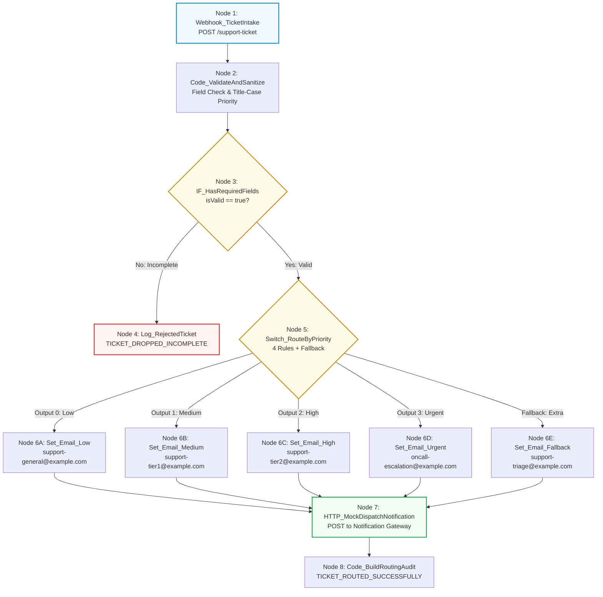

# Requirement Document: N8N Hands-On Intermediate Course
## Topic 4: Support Ticket Priority Routing & Conditional Logic

---

## 1. Document Control

| Field | Value |
| :--- | :--- |
| **Document Title** | Topic 4: Support Ticket Priority Routing & Conditional Logic - Requirement File |
| **Course** | N8N - Hands On Intermediate Course (Level 2) |
| **Target Audience** | Automation Builders, System Integrators, QA Engineers |
| **Version** | 1.0 |
| **Status** | Approved |
| **Last Updated** | June 28, 2026 |
| **Prepared By** | Lead Automation Architect |

---

## 2. Learning Concepts & Objectives

### 2.1 Course Objective
Build an automated enterprise support ticket triage and multi-branch routing workflow in n8n. The workflow ingests customer service tickets via an asynchronous HTTP webhook, validates mandatory fields, normalizes priority casing to prevent routing drift, directs valid requests across 4 distinct priority queues (**Low**, **Medium**, **High**, **Urgent**) plus an unrecognized **Fallback** queue using the n8n **Switch** node, generates custom email/alert payloads, and dispatches them to a simulated support notification gateway.

### 2.2 Learning Scope
* **Webhook Ticket Intake:** Exposing an ingestion endpoint (`POST /support-ticket`) that provides an immediate `200 OK` acknowledgment while processing tickets asynchronously.
* **Input Validation & Title-Case Sanitization:** Verifying presence of required payload fields (`customerName`, `customerEmail`, `subject`, `priority`) and standardizing priority strings (e.g. `'urgent'` or `'URGENT'` into `'Urgent'`).
* **Validation Gating (IF Node):** Isolating incomplete or malformed tickets and routing them to a rejected ticket log (`Log_RejectedTicket`).
* **Multi-Branch Conditional Routing (Switch Node):** Configuring an n8n Switch node with 4 equality rule outputs and an active extra Fallback output.
* **Tier-Specific Payload Formulation (Set Nodes):** Enriching routed items with dedicated recipient emails, target support queues, custom subject lines, and formatted body text.
* **Gateway Convergence & Dispatch:** Merging multi-branch outputs into a centralized HTTP Request node and logging completion audit records.

---

## 3. Workflow Architecture

---

## 4. Functional Requirements

| Requirement ID | Section | Requirement Description | Priority |
| :--- | :--- | :--- | :--- |
| **REQ-001** | Webhook Ticket Intake | The system shall ingest support ticket payloads via HTTP POST on path `/support-ticket` and return an immediate 200 acknowledgment. | High |
| **REQ-002** | Mandatory Field Validation | The pipeline shall check for `customerName`, `customerEmail`, `subject`, and `priority`. | High |
| **REQ-003** | Priority Casing Normalization | The pipeline shall normalize raw priority strings into Title-Case format to eliminate rule matching failures caused by case sensitivity. | High |
| **REQ-004** | Incomplete Ticket Quarantine | Payloads missing any required parameter shall be routed to `Log_RejectedTicket` with detailed `missingFields`. | High |
| **REQ-005** | Multi-Tier Routing Rules | The Switch node shall route tickets matching Low, Medium, High, and Urgent to their respective queue handlers. | High |
| **REQ-006** | Unrecognized Priority Fallback | Tickets with non-standard priority values (e.g. `'Critical'`, `'P1'`, empty) shall route to the Fallback queue handler (`support-triage@example.com`). | High |
| **REQ-007** | Notification Dispatch | Each priority branch shall formulate custom notifications and dispatch them to the centralized gateway endpoint. | High |
| **REQ-008** | Routing Audit Logging | Successfully routed notifications shall generate an audit record capturing `dispatchId`, `assignedQueue`, `targetRecipient`, and timestamp. | High |

---

## 5. Technical Specifications & Node Blueprint

| Node ID | Node Name | Node Type | Critical Role & Configuration |
| :--- | :--- | :--- | :--- |
| **N4-01** | `Webhook_TicketIntake` | Webhook | `POST /support-ticket`, response code: `200`, message: `"Ticket queued for routing"`. |
| **N4-02** | `Code_ValidateAndSanitize` | Code (JavaScript) | Evaluates mandatory parameters, lowercases email, and normalizes priority to Title Case. |
| **N4-03** | `IF_HasRequiredFields` | IF Node | Verifies `{{ $json.isValid }} == true`. |
| **N4-04** | `Log_RejectedTicket` | Code (JavaScript) | Logs dropped ticket events with `TICKET_DROPPED_INCOMPLETE`. |
| **N4-05** | `Switch_RouteByPriority` | Switch | 4 String Equality rules on `{{ $json.ticket.priority }}` plus active Fallback output. |
| **N4-06A** | `Set_Email_Low` | Set (Edit Fields) | Recipient: `support-general@example.com`, Queue: `General Tier 0 Queue`. |
| **N4-06B** | `Set_Email_Medium` | Set (Edit Fields) | Recipient: `support-tier1@example.com`, Queue: `Tier 1 Support Queue`. |
| **N4-06C** | `Set_Email_High` | Set (Edit Fields) | Recipient: `support-tier2@example.com`, Queue: `Tier 2 Technical Escalations`. |
| **N4-06D** | `Set_Email_Urgent` | Set (Edit Fields) | Recipient: `oncall-escalation@example.com`, Queue: `On-Call Urgent Page Desk`. |
| **N4-06E** | `Set_Email_Fallback` | Set (Edit Fields) | Recipient: `support-triage@example.com`, Queue: `Manual Triage Desk`. |
| **N4-07** | `HTTP_MockDispatchNotification` | HTTP Request | `POST https://httpbin.org/post` sending formatted JSON notification payload. |
| **N4-08** | `Code_BuildRoutingAudit` | Code (JavaScript) | Emits execution audit summary record (`TICKET_ROUTED_SUCCESSFULLY`). |

---

## 6. Verification Test Cases

| ID | Test Case | Steps | Expected Result | Priority |
| :--- | :--- | :--- | :--- | :--- |
| **TC-001** | Urgent Escalation | POST ticket with `priority: "Urgent"`. | Routes to `Set_Email_Urgent`, dispatches alert to `oncall-escalation@example.com`. | High |
| **TC-002** | Low Priority Normalization | POST ticket with `priority: "low"`. | Normalized to `"Low"`, routes to `Set_Email_Low` (`support-general@example.com`). | High |
| **TC-003** | Unrecognized Fallback Routing | POST ticket with `priority: "Critical"`. | Bypasses standard rules, hits Fallback output, routes to `Set_Email_Fallback`. | High |
| **TC-004** | Missing Required Fields | POST ticket omitting `customerEmail`. | Rejected at `IF_HasRequiredFields`, logged in `Log_RejectedTicket`. | High |

---

## 7. Production Risks & Mitigations

### 7.1 Risks
* **RSK-001 (Priority Case Sensitivity):** Uppercase/lowercase mismatches could cause valid tickets to trigger fallback queues unintentionally.
  * *Mitigation:* Explicit Title-Case normalization (`charAt(0).toUpperCase() + slice(1).toLowerCase()`) in the pre-validation node.
* **RSK-002 (Dispatch Gateway Downtime):** External notification provider failure could drop urgent triage alerts.
  * *Mitigation:* Apply retry policies with exponential backoff on the HTTP Request dispatcher.
